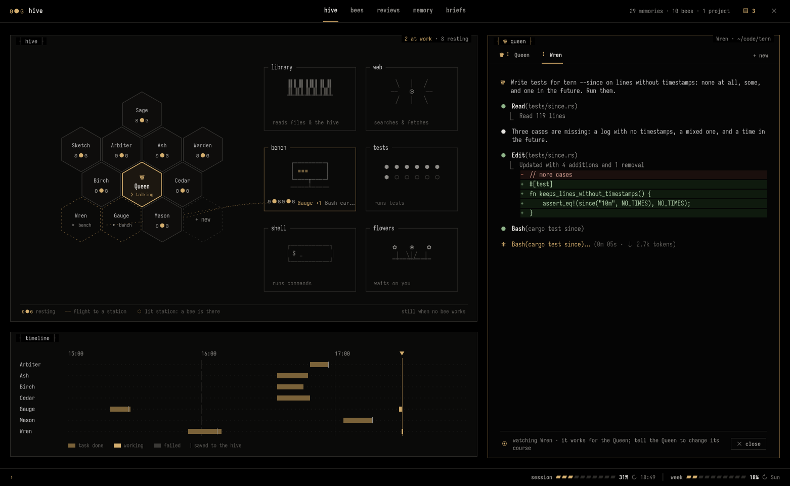
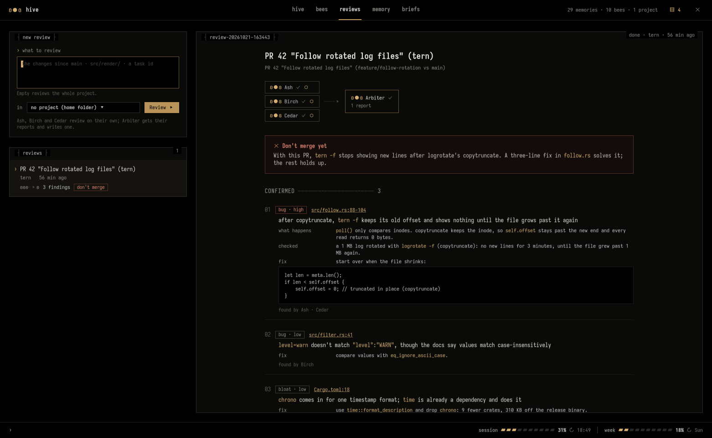

# Mellifera — agentic AI hivemind

Long-term memory and a crew of worker agents for Claude Code, kept on your own
computer. Instead of giving Claude hundreds of instructions, you keep a hive: a
Queen that every session reads, worker bees with their own specialties, and a
comb of everything they learned. Claude searches it when it needs something, so
the hive can grow without filling the context.



**[▶ Demo video](docs/media/demo.mp4)**, in a made-up demo hive (the project
"tern" and every bee in it are invented): you ask the Queen in the work pane,
her cell lights up "❯ talking", and she hands the work to the bee Wren. Its tab
opens beside hers and fills with its steps while it works, then shows ✓. A
finished task lands in the ▤ inbox, which opens from the header, and a click on
a bee opens its popover.

Version 0.1.04. The command and the folder are still called `hive` (`hive app`,
`~/Hive`); the rename to Mellifera only covers the project so far.

Mellifera is free and open source under the AGPL-3.0, and it stays that way: everything
in this repository runs on your own machine without an account. Paid **Pro** features and a
commercial licence will come on top of it; see [Licence](#licence).

- **The Queen** is the main Claude session. At the start of every session a
  hook gives it the briefing: `queen.md`, the bees, the projects, and the latest
  in the project whose folder the session is in.
- **Bees** are workers with a name, a specialty and the projects they serve.
  Each one is also a Claude Code subagent (`~/.claude/agents/<name>.md`), so the
  Queen can hand it work. Its card says how it works, and its briefing gives it
  the card, its projects and what the hive knows; what it deposits stays for
  the others. A fresh hive has no bees: you make them.
- **Molting** is a bee changing its own card when it learns something. You
  choose which bees may do that themselves (`molt: free`); for the rest
  (`molt: approve`, the default) the change waits for you in `hive molts`.
- **The comb** holds entries: facts, decisions, worklogs, lessons, preferences
  and notes. When something changes, the new entry supersedes the old one; the
  old one stays readable but drops out of search.

## Requirements

Linux with SQLite and Claude Code (developed on Arch with Hyprland). The window
needs GTK 4.12 or newer and libadwaita 1.6 or newer, and says so at start if
they're older (Ubuntu 24.04 ships libadwaita 1.5); the CLI and the MCP server
don't load GTK at all. The hive runs `setsid`, `diff` and `xdg-open`
(util-linux, diffutils, xdg-utils).

To build: the .NET 10 SDK, plus clang and the zlib development headers for the
NativeAOT build (`clang zlib` on Arch, `clang zlib1g-dev` on Debian and Ubuntu).

The window uses Fira Code with Symbols Nerd Font Mono for icons
(`pacman -S ttf-fira-code ttf-nerd-fonts-symbols-mono`); without them it falls
back to the system monospace font and plain Unicode symbols.

## Install

```sh
./build.sh          # NativeAOT build, installed to ~/.local/bin/hive
hive install        # makes ~/Hive, adds the MCP server, the hooks, the bee
                    # subagents, the status line and the launcher entry
```

Claude Code has a memory of its own (auto memory). On a terminal, `hive
install` asks whether to turn it off (`autoMemoryEnabled: false`), so
"remember this" lands only in the hive; the default is no. For scripts,
`hive install --auto-memory off` or `--auto-memory keep` answers it; with no
terminal and no flag, it's left as it is. It sets Claude Code's status line
to `hive statusline` only when you don't have one. `hive uninstall` takes it
all out of Claude Code again and leaves the hive's files alone. It turns auto
memory back on only if `hive install` turned it off (it keeps a note of that in
`~/.local/share/hive/auto-memory-off`); if you turned it off yourself, or a
`hive install` from before this change did, it stays off. `HIVE_HOME` puts the
hive somewhere other than `~/Hive`.

## Hooks

| Event | What the hive does |
|---|---|
| SessionStart | Hands the session the Queen's briefing, or a bee's own briefing when it runs as that bee (every task does) |
| SubagentStart | Hands a bee its briefing as the Queen spawns it, so it never starts cold |
| SubagentStop, Stop | A bee whose card asks for it (`deposit_before_stop: yes`) and that saved nothing is sent back once to save. Reviewers in a team run are exempt (they stay blind), and so are your own chats with a bee |
| SessionEnd | Ends a chat's place in the window |
| PreToolUse (Bash) | Bees with the reviewer or overseer role may only read: git log, diff, show, status and blame, ls, wc and du, one command at a time, with no `--output` or `--ext-diff`. Anything else is refused, in every permission mode. Other sessions and bees pass straight through |

Briefings stay under 9,000 characters, below Claude Code's 10,000-character
limit for hook context; "waiting for the user" is never the part that's cut.

## Making bees

A fresh hive is empty: no bees, no cards, no skills. You make each bee from
what you type, with **+ new** in the window or from a terminal:

```sh
hive new-bee Mason --specialty "Builds features in C#" --projects myapp \
  --instructions "Smallest change that does the job. Build and run the tests before you finish."
hive bee Mason --skills my-plugin:my-skill   # skills loaded when its session starts
hive bee Mason --molt free                   # may change its own card
```

Its card (`~/Hive/bees/Mason.md`) starts with **How I work** (what you gave as
instructions) and **Rules I've learned** (empty: "None yet."). Edit it on the
bee's page, or let the bee propose changes with `bee_molt`.

Settings in a card's front matter that the hive acts on:

| Setting | |
|---|---|
| `role: reviewer`, `role: overseer` | the bees a team review uses (see below) |
| `role: evolver` | the bee that reviews other bees' records (`hive evolve`, and by itself after enough outcomes) |
| `role: keeper` | in a read task, may also tidy the hive and set project briefs |
| `evolve_after: 5` | on the evolver: new honey or miss outcomes a bee needs before it's reviewed by itself (0: never) |
| `deposit_before_stop: yes` | sent back once if it stops a task without saving anything to the hive |
| `access: read` | the access its tasks start with |

Set them on the bee's page or with `hive bee <Name> --role evolver`,
`--evolve-after 5`, `--deposit-before-stop yes`.

Task access levels:

- **Read and research**: files, the web, reading the hive, saving entries to
  it and proposing card changes, and read-only `git`, `ls`, `wc`, `du`. It
  can't create bees or replace project briefs, except that a bee with the
  keeper role may tidy and set briefs, and one with the evolver role may read
  a bee's record.
- **Can edit files and build**: also every hive tool, skills, edits in the
  project's folder, `ps`, and the commands in your settings (below; `make` and
  `./build.sh` unless you change them). Since a bee can write a script or a
  build step and then run it, this amounts to running any code the project
  builds, and a skill may allow more tools while it runs: give it only to bees
  and folders you'd trust with that.
- **Anything**: no permission checks.

The commands an edit task may run are a hive-wide setting, in the front
matter of `~/Hive/settings.md` (make the file if it isn't there). Each one
allows that command with any arguments; `[]` allows none:

```yaml
---
edit_commands: [make, ./build.sh, cargo build, cargo test, npm run]
---
```

Each bee's card has a default, and the task box starts on it. Whatever the
level, a card change a task proposes counts as that bee's own: it only takes
effect at once for the bee itself, and only if that bee may molt freely.

## The window

`hive app`, or **Hive** in your app launcher, opens it. It's a GTK 4 /
libadwaita window dressed as a terminal: monospace text, panels framed in thin
lines with their title in the border, honey on black, always dark (its
stylesheet sits above the gtk.css matugen writes, so the wallpaper doesn't
change it). It moves when something happens, and with no bee working nothing
moves at all: no frame callbacks and no CPU at rest. With animations off
(GNOME's setting), bees jump instead of flying. Screen readers hear one
sentence per bee and per work line; the character art is hidden from them.

- **Hive.** A honeycomb with the Queen in the middle and each bee resting in
  its cell (`ʚ●ɞ`). A bee at work leaves its cell (the cell goes dashed and
  says where it went) and flies along a dashed path to the station for what it
  does right now: the **library** while it reads files or the hive, the
  **web** for searches and fetches, the **bench** while it edits or builds,
  **tests**, the **shell** for other commands, and the **flowers** while it
  waits on you. A station's frame lights up while a bee is there. Click a bee
  for what it's doing, **Stop**, a task box and its page. Under the scene,
  the **Timeline**: a lane per bee, bars for runs (done, working, failed),
  ticks for saves, ▼ for now.
- **The Queen's pane.** Beside the hive, the page's full height, the work
  pane: you talk to the Queen, and she hands the work to the bees. It reads
  like a Claude Code session: `❯` for you, `●` for her, tool calls with their
  results under `⎿`, diffs, and a working line with time and tokens. Each
  message continues the window's conversation with her (`claude -p --resume …
  --output-format stream-json`, with the Queen's briefing, as in your own
  sessions), even after a restart, until you press **+ new**. Pick the folder
  she works in at the top right. Her cell in the hive says **❯ talking**
  while she answers, and esc stops her. A turn can't ask you for permission,
  so a tool outside the chosen mode fails with a red line; switch modes with
  shift+tab (it starts at accept edits) and send again. Handing work on is
  always allowed. The model in the status line is a menu: **default** (your
  own default model, no `--model`), Opus 5.5, Sonnet 5.5, Haiku 4.5 or Fable
  5.1, for her next turns; it's kept with the conversation, after a restart
  too, and **+ new** goes back to default.
- **Dictation.** The mic beside the `❯` prompt, or **alt+v**, records you
  (`pw-record`, 16 kHz mono, into your runtime folder); press again to stop,
  or hold alt+v and let go. Then `whisper-cli` (whisper.cpp) transcribes it
  locally and the text goes into the prompt at the cursor, for you to edit
  and send: it's never sent by itself. It needs `pw-record` (PipeWire),
  `whisper-cli` on PATH and a ggml model at
  `~/.local/share/hive/whisper/ggml-*.bin` (`$XDG_DATA_HOME/hive/whisper`;
  the first by name is used, e.g. `ggml-base.en.bin` from
  huggingface.co/ggerganov/whisper.cpp). Without them the mic is hidden and
  the `❯`'s tooltip says what's missing. Nothing is linked into hive, and
  nothing runs between dictations.
- **Bee tabs.** When the Queen hands work to a bee, a tab opens beside hers
  with that bee's own transcript, live, whether it works in the foreground or
  the background: a spinner while it works, then ✓ or ✗. You watch; to change
  its course, tell the Queen. Her turn lasts until her bees are done, and
  stopping her stops them too. A finished tab stays until you close it or
  start a new conversation.
- **Inbox.** **▤** in the header, with how many things wait (dim when none):
  card changes, finished tasks to judge, failed tasks and finished reviews,
  each approved, given honey, opened or dismissed right there.
- **Bees.** Every bee with its state (working, waiting on you, resting). A
  bee's page: its vignette, specialty and projects, **give a task**, its card
  rendered (edit opens the editor), what it's doing now, its
  card history (approved and rejected changes, as diffs), and its recent work.
  New bee, retire bee.
- **Reviews.** Start a team review (see below) and read the runs. The
  overseer's report is rendered: a verdict box, numbered findings with a
  severity tag, file:line links that open the file, code blocks, and a
  **honey for** row: if the report has a Reviewers table with each reviewer's
  confirmed findings, the hive gives each reviewer honey (⬡) for one or more
  and a miss (✗) for none; click one to take it back.
- **Memory.** Search everything, filter by type and project, read any entry
  with its front matter as a file header, the entries it replaces or that
  replaced it, and Copy id.
- **Briefs.** What sessions are told: the Queen (`queen.md`) and each
  project's brief in an editor, and "what Claude sees": the exact briefing a
  session gets (with no project or in a project, as the Queen's session or as
  a bee), a 48-cell meter against the 9,000-character cap, and the size of
  each section, live as you type.
- **Usage.** The footer shows your Claude plan's session (5-hour) and weekly
  limits with their reset times; click it for the details and a warning at
  80%. `hive statusline` saves the `rate_limits` Claude Code hands its status
  line, so the numbers update whenever a session runs and go stale while none
  does. With no data it says so instead of showing numbers.



Retiring a bee, approving or rejecting a card change, taking honey back and
undoing a card change happen at once, with **Undo** in the status line for 10
seconds instead of a dialog asking first. Narrower than 900 px, the window
shows one pane at a time, the tabs move to the bottom, and the Queen's pane
becomes a sheet you pull up from under the hive. It updates by itself: when a Claude session or a bee
saves something, it shows up within two seconds.

### Tasks

Each bee's page has a **give a task** box. The bee works on the task in the
background as its own Claude Code session (`claude -p --agent <bee>`, its
steps streamed as they happen), in the folder of the project you pick.
Closing the window doesn't stop it. Open a
task for its live step log, the result, honey, **Follow up** (the same bee
carries on in the same session), **Hand to…** (another bee takes it from
there with the result) and the `claude --resume` command that continues it
in a terminal. From a terminal: `hive task Scout "what to do" --project
myapp`, `hive tasks`, `hive stop <id>`, and `hive talk Scout` for a
conversation in your terminal.

### Honey, misses and the evolver

Mark a bee's work as **honey** (on point) with the button on a finished task
or on any memory a bee wrote, with a note if you like; a bee's briefing lists
its work that earned honey. A **miss** (`reward: no`) marks work that fell
short. Each records who gave it (`reward_by`): you, `queen` (a session with
the `bee_reward` tool, which needs a note on what it rests on), or `hive` (a
team review's count, below). A bee's own work and a bee as the giver are
refused, and what you or the hive recorded, a session can't change. Take any
of it back with the same button, or `hive unreward <id>`.

Give one bee the **evolver** role and it can review the others: **Evolve** on
a bee's page (or `hive evolve <Bee>`) starts it on that bee's record
(`bee_review`: its card, its card's history, its tasks, and its honey and
misses with who gave each and why). It also starts by itself once a bee has
`evolve_after` (5 unless its card says otherwise) new honey or miss outcomes
since its last review, never two at once for a bee, and never on itself. How
it reviews is up to its card. A card change it proposes for another bee that
only adds list items at the end of "## Rules I've learned" (in place of a
lone "None yet."), each citing two or more of that bee's honey or miss ids,
applies at once: the inbox shows it as applied, with **Undo** (the change then
waits for you like any other), and the card history marks it. Every other
proposed change waits for you in the inbox and on the bee's page, unless it's
a bee's own and you let it molt freely. **Undo last change** on a bee's page
puts its previous card back. A proposed card only changes the body, the
specialty and the projects; it can't change its own `molt`, `role` or `access`.

From a terminal: `hive reward <id or task:id> --note "..."`, `hive evolve <Bee>`,
`hive review <Bee>`, `hive undo-card <Bee>`.

### The review team

A team review runs one job across your bees: the ones with the **reviewer**
role look at what you name (a project, "the changes since main", a folder, a
task) at the same time and blind: they save nothing during the run, so none
can see another's report. When they're done, the bee with the **overseer**
role gets all their reports and writes one, which is the review's report. How
each one reviews is up to its card.

If the overseer's report has a table under `## Reviewers` whose first column
is a reviewer and second how many of its findings it confirmed
(`| reviewer | confirmed | … |`), the hive records honey for each reviewer
with one or more and a miss for one with none.

Set the team up with **Set up the review team** on the Reviews page, or
`hive team setup Ash Birch Cedar Judge` (the reviewers, then the overseer):
existing bees get the roles, and new names become bees with empty cards.

**From any Claude session:** `team_review_begin` starts a run and returns
each reviewer's prompt to spawn as a subagent; `team_review_report` hands in
each reply and, after the last reviewer, returns the overseer's prompt. The
run shows in the Reviews tab like a background one.

Reviewers and the overseer get read-only access: files, search, the web, and
reading the hive and saving entries to it. Run in the background, they also
get single `git log/diff/show/status/blame` commands. Spawned by a session,
their subagent files give them no shell at all, so there they read the files
but can't run `git`. From a terminal:
`hive team review --project myapp "the changes since main"`,
`hive team runs`, `hive team show <run>`.

## Use

```sh
hive new-bee Forge --specialty "Engine work in C#" --projects myapp
hive new-bee Scout --specialty "Research and reading docs" --molt free
hive bee Forge --molt free            # let Forge change its own card
hive project myapp --summary "My app" --path ~/Projects/myapp
hive search wayland idle
hive molts                            # card changes waiting, as diffs
hive approve <molt id>
hive tidy                             # duplicates, broken links, molts waiting
hive import ~/.claude/projects/<project>/memory --project myapp
hive --help
```

Or ask Claude: "make a bee called Forge for engine work", "remember that…",
"what did we decide about…".

## On disk

```
~/Hive/
  queen.md                  read into every session; keep it short
  settings.md               the hive's settings (front matter: edit_commands)
  bees/<Name>.md            a bee's card (front matter: specialty, projects, molt, role, …)
  bees/.molts/              card changes waiting for you
  bees/.history/            old cards, approved and rejected molts
  projects/<name>/brief.md  summary, folders, and the brief
  comb/<project>/<id>.md    entries; comb/global/ for hive-wide ones
  .tasks/                   background tasks and their step logs, and the Queen pane's turns
  .state/                   bees at work right now, and usage.json
  .talk/                    `hive talk` chats with a bee that are still going
  .dismissed                inbox items you dismissed
  .usage-warn               whether the 80% usage warning is on or off
  .index.db                 SQLite FTS5 index, rebuilt from the files
```

It's all plain Markdown with front matter, so you can open `~/Hive` as an
Obsidian vault and edit anything there. The index notices changed files on the
next search. Put it in git if you want history.

## MCP tools

| Tool | |
|---|---|
| `hive_brief` | the Queen's briefing, or a bee's (card, projects, lessons, others' recent work) |
| `hive_recall` | search; one line per hit, best first (BM25 over title, summary, tags, body) |
| `hive_read` | the whole entry, card or brief |
| `hive_deposit` | save a fact, decision, worklog, lesson, preference or note; `supersedes` replaces old ones |
| `hive_tidy` | likely duplicates, broken links, molts waiting |
| `bee_list`, `bee_create`, `bee_molt`, `bee_review`, `bee_reward` | the bees |
| `project_set` | make or change a project |
| `team_review_begin`, `team_review_report` | run a team review from a session |

## Weight

One 4.1 MB native binary, no NuGet packages. SQLite, GTK 4, libadwaita, Pango
and cairo are the system libraries, bound by hand, and GTK only loads when the
window opens. Measured before the window redesign: the MCP server idles at
about 11 MB with no CPU use, the window at about 80 MB (nearly all GTK), also
with no CPU use while idle. With 3,500 entries a search takes about 9 ms and
the session briefing 12 ms. There's no embedding model: keyword search with
stemming is enough at this scale, and nothing loads onto the GPU.

Tests: `tests/run.sh` (DocTests 50, StoreTests 68, WindowTests 111; the window
tests run headless under gtk4-broadwayd).

## Licence

Mellifera is **dual-licensed**.

- **AGPL-3.0** ([LICENSE](LICENSE)): use it, change it and share it for free. If you
  distribute a changed version, or let people use one over a network, you publish your
  changes under the same licence.
- **Commercial licence:** for building Mellifera into a closed product or service without
  the AGPL's terms. Open an issue titled "Commercial licence" to ask.

The free version keeps everything that runs on your own machine. **Pro** (planned, paid)
adds things that need a server or are for teams, such as encrypted sync and backup across
machines, shared team hives and ready-made bee packs. Pro will live outside this
repository.

Mellifera drives Claude Code with your own Claude account. It doesn't include or resell
access to Claude.

Contributions: see [CONTRIBUTING.md](CONTRIBUTING.md).
